

<a href="https://cursed-entertainment.itch.io/">
  
</a>

  

&nbsp;

&nbsp;

 

&nbsp;

  

**Cursed Entertainment** is an independent studio making games, robots, creative software and AI tools. 
Everything here is built in-house, from the C++ engines and desktop apps to the robot firmware.

 

 

  
  
   
  
   
  

  <picture>
    <source media="(prefers-color-scheme: dark)" srcset="https://raw.githubusercontent.com/CursedPrograms/CursedPrograms/output/snake-dark.svg">
    <source media="(prefers-color-scheme: light)" srcset="https://raw.githubusercontent.com/CursedPrograms/CursedPrograms/output/snake-light.svg">
    
  </picture>

 

 

<table>
<tr>
<td width="33%" align="center" valign="top">
  <a href="https://cursedprograms.github.io/comets-and-the-commander/">
    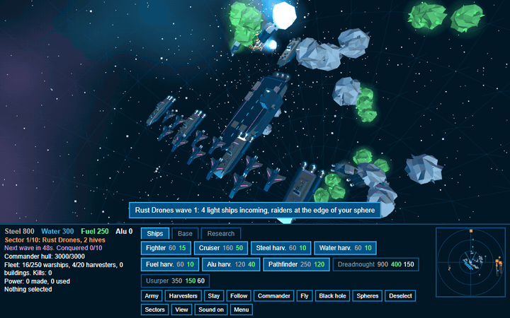
  </a>
  <h3>Comets and the Commander</h3>
  
A 3D space RTS in your browser. Mine comets, build a fleet, conquer ten sectors.

  
</td>
<td width="33%" align="center" valign="top">
  <a href="https://cursedprograms.github.io/KillerStardust/">
    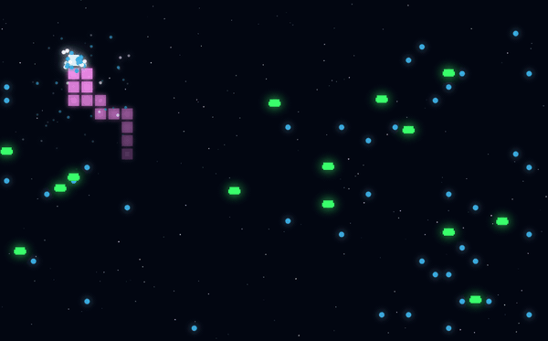
  </a>
  <h3>Killer Stardust</h3>
  
The first Cursed Arcade cabinet. An 80s neon snake with a deadly appetite.

  
</td>
<td width="33%" align="center" valign="top">
  <a href="https://cursedprograms.github.io/guest_000/">
    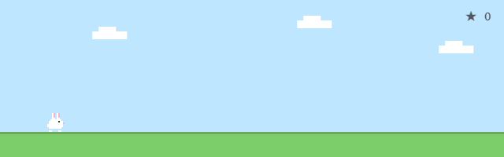
  </a>
  <h3>guest_000</h3>
  
A browser horror game. It starts somewhere innocent.

  
Flashing images and sudden loud sounds.

  
</td>
</tr>
</table>

<table>
<tr>
<td width="33%" align="center" valign="top">
  
  <h4>Araknia</h4>
  
A third-person gothic horror experience.

  
</td>
<td width="33%" align="center" valign="top">
  
  <h4>Nystylla: Girls of Maluxzka</h4>
  
A third-person survival sandbox.

  
</td>
<td width="33%" align="center" valign="top">
  
  <h4>Arise Mexzmiriah</h4>
  
A third-person arcade shooter.

  
  
</td>
</tr>
<tr>
<td width="33%" align="center" valign="top">
  
  <h4>Mirror Macabre</h4>
  
A two-player board game.

  
  
</td>
<td width="33%" align="center" valign="top">
  
  <h4>Retrofizia - Beginning</h4>
  
An 80s retrowave 3D platformer.

  
</td>
<td width="33%" align="center" valign="middle">
  
  
Every Cursed game, on itch.io.

</td>
</tr>
</table>

 

 

<b>DREAM Robotics</b>: a fleet of robots with names, voices and personalities, driven by local AI.

<table>
<tr>
<td width="33%" align="center" valign="top">
  
  <h4>DREAM</h4>
  
An offline AI companion with an inner life: voice, memory, moods and a face.

</td>
<td width="33%" align="center" valign="top">
  <a href="https://github.com/CursedPrograms/KIDA-Robot-v01">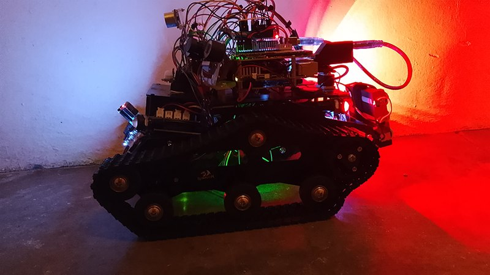</a>
  <h4>KIDA-01</h4>
  
A Raspberry Pi 5 tank with a Hailo AI accelerator, night vision and a local LLM.

</td>
<td width="33%" align="center" valign="top">
  <a href="https://github.com/CursedPrograms/WHIP-Robot-v00">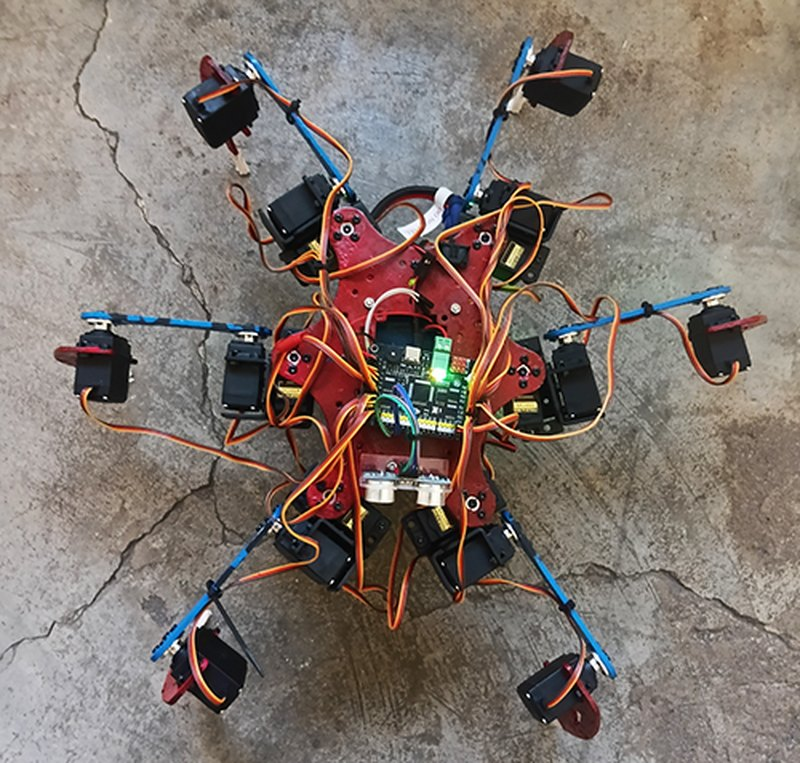</a>
  <h4>WHIP</h4>
  
An 18-servo ESP32 hexapod with gaits, tilt safety and a gamepad.

</td>
</tr>
<tr>
<td width="33%" align="center" valign="top">
  <a href="https://github.com/CursedPrograms/NORA-Robot-v00">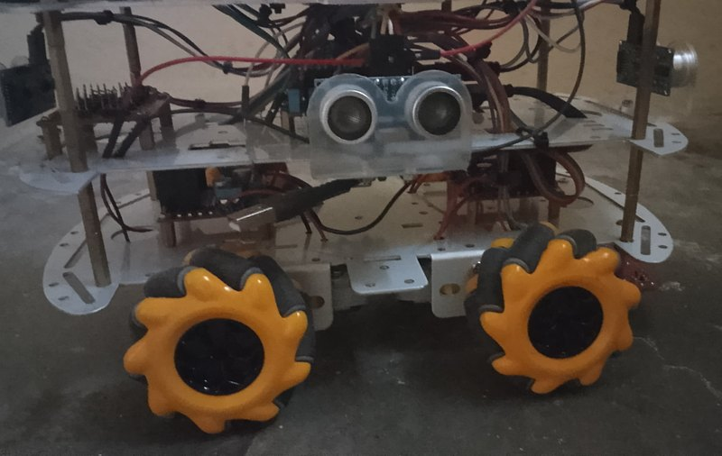</a>
  <h4>NORA</h4>
  
A mecanum-wheeled ESP32 robot and the fleet's WiFi hub.

</td>
<td width="33%" align="center" valign="top">
  <a href="https://github.com/CursedPrograms/TINA">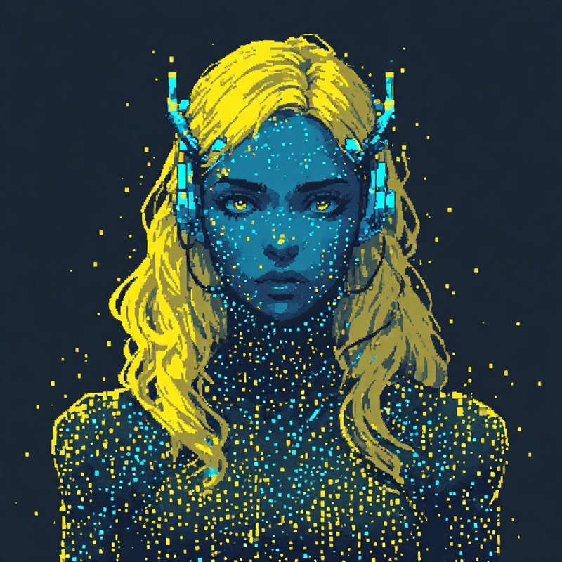</a>
  <h4>TINA</h4>
  
The fleet's engineer: a local LLM agent that reads, writes and checks the robots' code.

</td>
<td width="33%" align="center" valign="top">
  <a href="https://github.com/CursedPrograms/RIFT">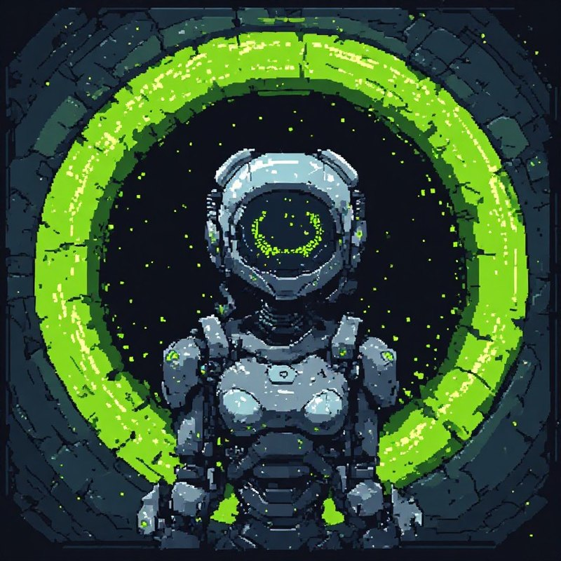</a>
  <h4>RIFT</h4>
  
The fleet hub: robot registry, discovery and a live dashboard.

</td>
</tr>
</table>

 

 

<b>Atelier</b>: a creative and studio suite of desktop apps, written in C++.

<table>
<tr>
<td width="33%" align="center" valign="top">
  <a href="https://github.com/CursedPrograms/Chimera">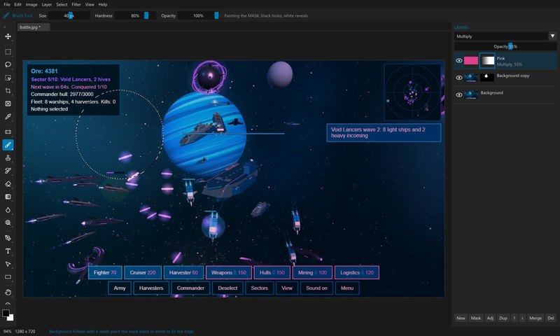</a>
  <h4>Chimera</h4>
  
A layer-based image editor: layers, masks, blend modes and filters.

</td>
<td width="33%" align="center" valign="top">
  <a href="https://github.com/CursedPrograms/Diorama">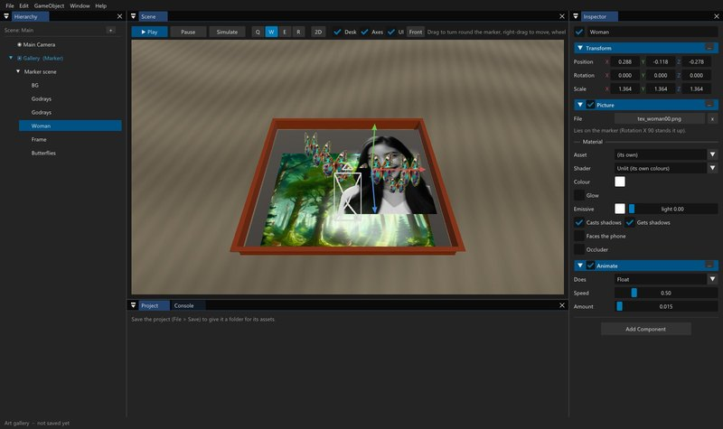</a>
  <h4>Diorama</h4>
  
An augmented reality engine: scenes on printed markers, played in a phone browser.

</td>
<td width="33%" align="center" valign="top">
  <a href="https://github.com/CursedPrograms/Firmament">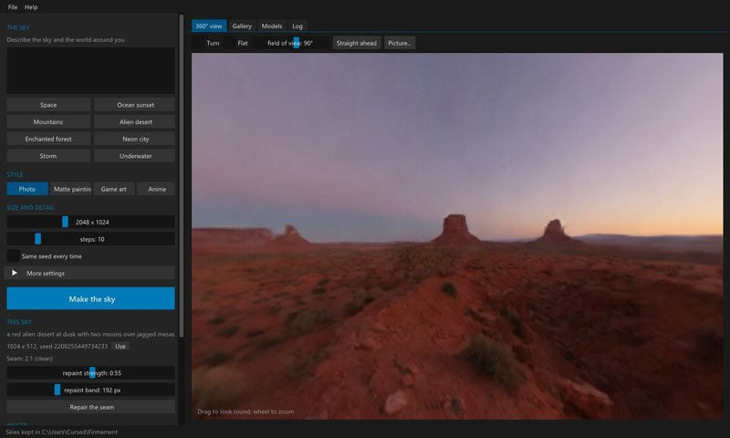</a>
  <h4>Firmament</h4>
  
360° skyboxes from a prompt, on your own GPU, up to 8K.

</td>
</tr>
<tr>
<td width="33%" align="center" valign="top">
  <a href="https://github.com/CursedPrograms/Hymnal">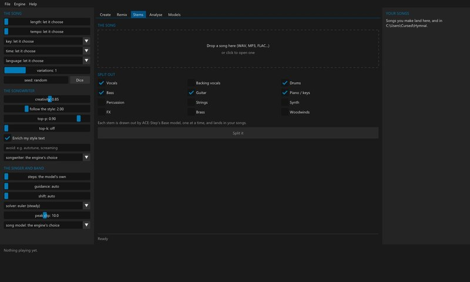</a>
  <h4>Hymnal</h4>
  
Whole songs with vocals, made on your own PC.

</td>
<td width="33%" align="center" valign="top">
  <a href="https://github.com/CursedPrograms/Atelier">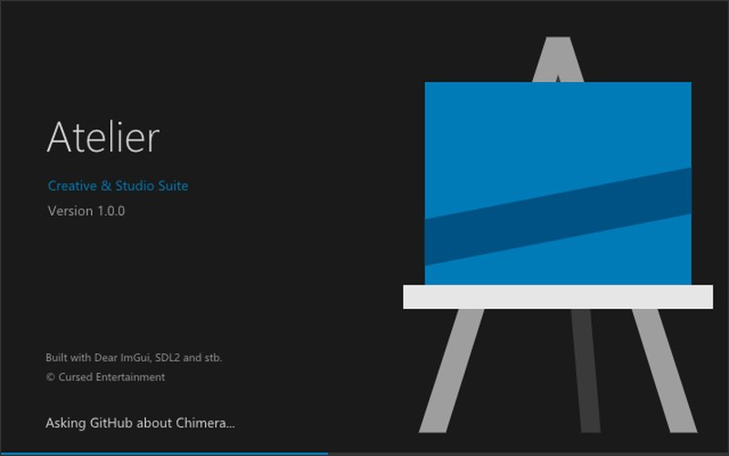</a>
  <h4>Atelier</h4>
  
The launcher: install, update and start every app from one window.

</td>
<td width="33%" align="center" valign="middle">
  
</td>
</tr>
</table>

 

 

<table>
<tr>
<td width="50%" align="center" valign="top">
  
  <h4>Mosaic Mask</h4>
  
A scramble suit for video calls: your face as a shifting mosaic of AI-generated strangers.

</td>
<td width="50%" align="center" valign="top">
  <a href="https://github.com/CursedPrograms/Changeling-Studio">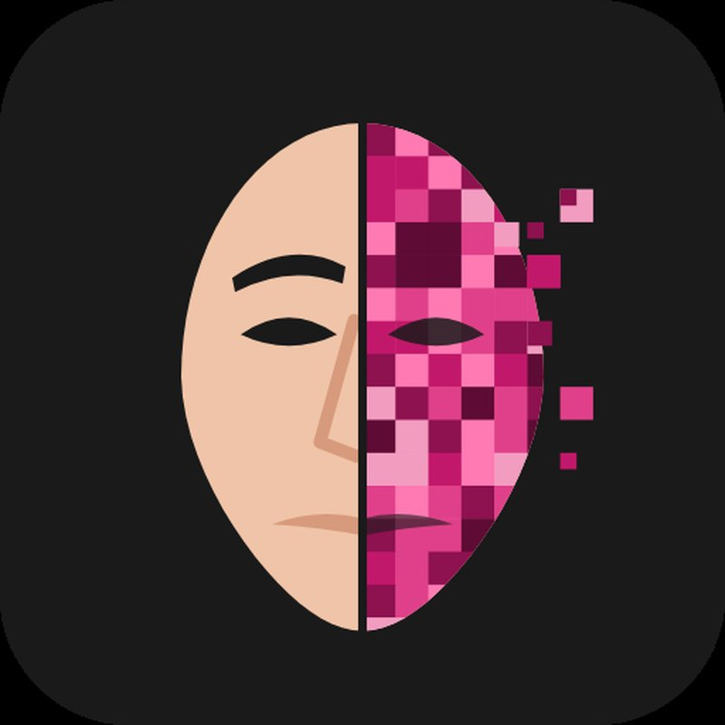</a>
  <h4>Changeling Studio</h4>
  
Face swap, age, gender, makeup, hair and voice, in photos and live.

</td>
</tr>
<tr>
<td width="50%" align="center" valign="top">
  
  <h4>Changeling Imago</h4>
  
One face onto any photo or video, with clean-up.

</td>
<td width="50%" align="center" valign="top">
  <a href="https://github.com/CursedPrograms/Changeling-Chronos">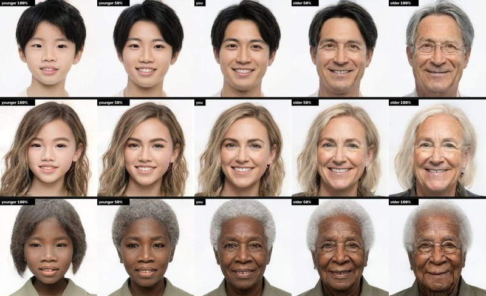</a>
  <h4>Changeling Chronos</h4>
  
A face younger or older, or a five-age timeline.

</td>
</tr>
</table>

 

 

<b>Everything else</b>

 

**Tools & software**

**Languages**

**Python libraries**

**Hosting**

 

 

  

© Cursed Entertainment 2026

  

  

